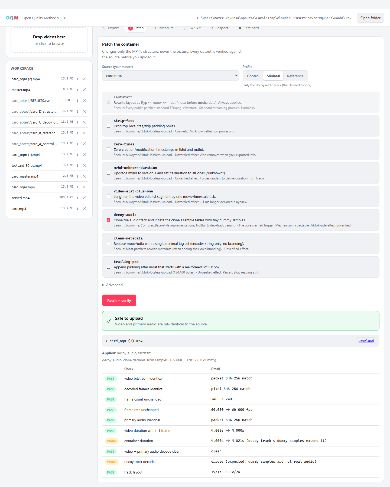

# OQM: Open Quality Method

A free tool to stop TikTok from crushing the quality of your edits. It runs on your PC and doesn't upload anything.

## What it does

OQM adds a hidden extra audio track to your MP4 (the "decoy"). Your picture and sound don't change at all, and OQM checks that before it saves.

In our first test, TikTok served the patched files **exactly as uploaded, at 1080p 60 fps**. The same video without the patch came back at 576p 30 fps.

| Upload | What TikTok served |
|---|---|
| **C: decoy only** | 1080p · 60 fps · 11.5 Mbps, untouched |
| **B: full method** (decoy + 7 other patches) | 1080p · 60 fps · 11.5 Mbps, untouched |
| D: the 7 other patches, no decoy | 576p · 30 fps · 1.5 Mbps, re-encoded |

That first round pointed at the decoy track as the trigger, so C (fewest changes) was the default. Later testing didn't hold up the same way - C alone stopped being enough. **The app now always applies the full method (all 8 patches)**, since that's what's actually been working; it no longer asks you to pick. The A/B kit still builds all four arms if you want to re-test this yourself - TikTok's behavior moves, so what matters today may not tomorrow (see [TEST-PROTOCOL.md](docs/TEST-PROTOCOL.md)).

## Setup (once)

1. Install **Python**: https://www.python.org/downloads/ (tick **"Add python.exe to PATH"**)
2. Install **FFmpeg**: open a terminal and run `winget install Gyan.FFmpeg` (the launcher can do this for you)
3. Download this repo: green **Code** button → **Download ZIP** → unzip

## Use it

Double-click **`Start OQM.bat`** (or `start-oqm.command` on Mac) and it opens in your browser, on the **Make** tab. Drop your video in, set a target bitrate (or leave it blank to use quality/CRF mode instead) and your frame rate/size, and hit **Make it**. It exports a clean master and applies the full patch in one step, then verifies the result before you upload it.

## Tips

- Export from your editor at the highest quality it offers first (ProRes, DNxHR, or a high-bitrate file). OQM can't add quality that isn't there - it can only re-encode once, cleanly, on the **Make** tab.
- Test on a second account first.
- Check the upload on your phone: sound, seeking and looping.

## Heads up

This is one test. TikTok can change how it processes uploads at any time, so nothing here is guaranteed. The patch makes an unusual file on purpose. It's not affiliated with TikTok, and using it might go against their terms, so that's your call.

## More

- [How it works](docs/METHOD.md), byte by byte
- [Run your own A/B test](docs/TEST-PROTOCOL.md) - `python -m oqm abtest` builds all four versions, `oqm measure` scores what came back
- [What the paid methods actually do](docs/LANDSCAPE.md)
- Command line: `python -m oqm --help` (export, patch, verify, measure, abtest, inspect, patches, testcard - everything the app's Make tab doesn't expose)

Based on public work by [buwryme/tiktok-lossless-upload](https://github.com/buwryme/tiktok-lossless-upload) and others. MIT license.
